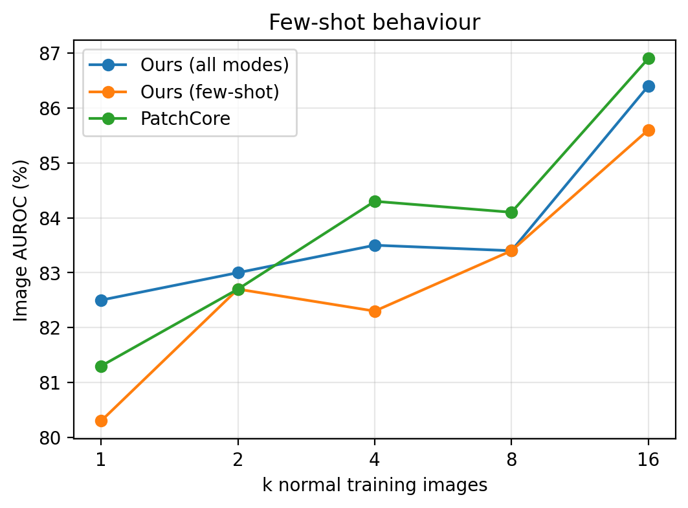
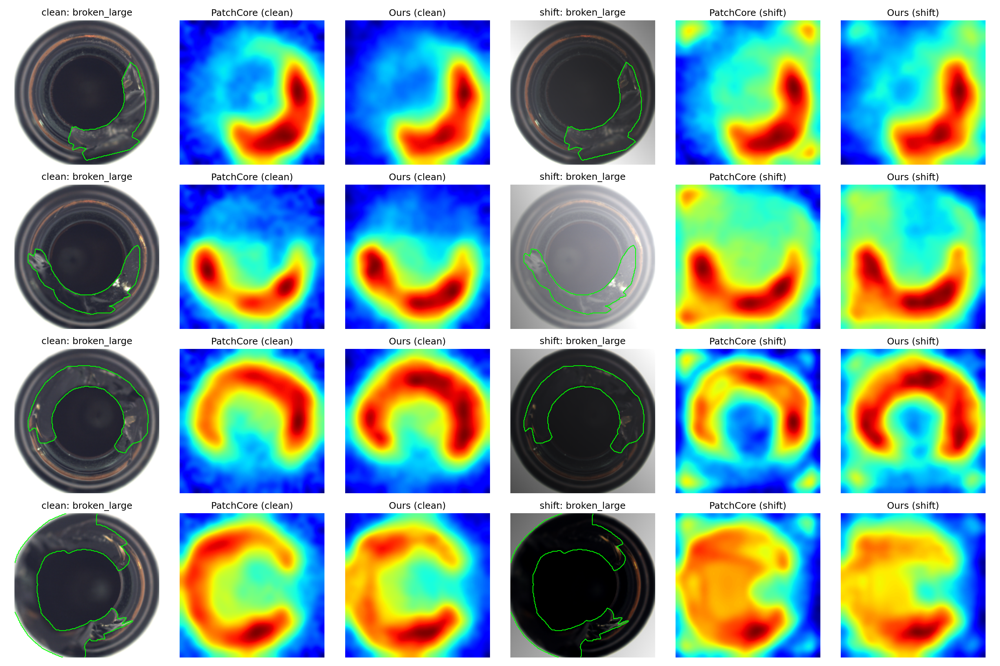
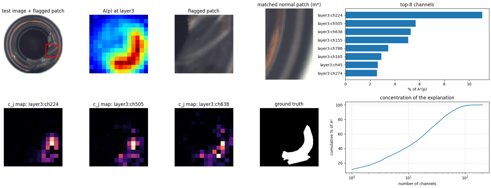

# Explainable Unsupervised Surface Defect Detection with Feature Selection

Code and raw results for the paper **"An Efficient and Explainable Unsupervised Framework for Industrial Surface Defect Detection Using Multi-Scale Feature Learning."**

The method keeps the PatchCore pipeline but changes what goes into the memory bank. Patch descriptors from an ImageNet Wide ResNet-50 are filtered with unsupervised feature selection before matching:

- **Few-shot mode:** variance filter, then Laplacian score on a heat-kernel nearest-neighbour graph.
- **Illumination mode:** Laplacian score on a graph with extra edges between each patch and its photometrically perturbed copy, then a correlation filter.
- **Multi-scale mode:** a separate memory bank per backbone stage, SPEC ranking per stage, and softmax-weighted fusion of the stage-level maps.
- **Explanation:** the squared anomaly score splits exactly into per-channel terms, so every flagged region comes with its top channels, their contribution maps and the matched normal patch.

No network weights are trained. Fitting only estimates channel masks, memory banks and normalisation constants.

## Run it

Everything is in one notebook: [`SelectiveCore_Surface_Defect_Detection.ipynb`](SelectiveCore_Surface_Defect_Detection.ipynb).

1. Open [Google Colab](https://colab.research.google.com), choose **File → Upload notebook** (or **File → Open notebook → GitHub** and paste this repository's URL), and select the notebook.
2. Choose **Runtime → Change runtime type → T4 GPU**.
3. Choose **Runtime → Run all**.

Section 2 of the notebook downloads MVTec AD from a public Kaggle mirror. If Kaggle asks for credentials, upload your `kaggle.json`, or put the official MVTec AD archive in Google Drive and set `SOURCE = "drive"`.

The default run uses three categories (`bottle`, `carpet`, `screw`) and takes about 30 minutes on a T4. For all 15 categories, set `CFG["run_categories"] = CFG["all_categories"]` in Section 1. Results are written after every category, so an interrupted run resumes where it stopped.

To run locally instead of Colab: `pip install -r requirements.txt`, then open the notebook in Jupyter and remove the `!pip` lines.

## Results (bottle, carpet, screw; means over 3 random draws)

**Few-shot image AUROC (%), clean test images**

| Method | k = 1 | k = 2 | k = 4 | k = 8 | k = 16 |
|---|---|---|---|---|---|
| PatchCore (same pipeline) | 81.3 | 82.7 | 84.3 | 84.1 | 86.9 |
| Ours (few-shot mode) | 80.3 | 82.7 | 82.3 | 83.4 | 85.6 |
| Ours (all modes) | 82.5 | 83.0 | 83.5 | 83.4 | 86.4 |

**Ablation under synthetic lighting shift (k = 16)**

| Configuration | Img. AUROC | Pix. AUROC | AU-PRO | Channels | Bank (MB) | ms / image |
|---|---|---|---|---|---|---|
| PatchCore | 73.9 | 84.1 | 52.4 | 1536 | 7.70 | 28.5 |
| + variance filter | 75.4 | 85.6 | 56.3 | 1382 | 6.93 | 28.4 |
| + Laplacian score | 64.0 | 81.6 | 47.4 | 307 | 1.54 | 27.6 |
| + consistency graph | 74.1 | 89.2 | 62.6 | 307 | 1.54 | 26.8 |
| + correlation filter | 74.3 | 89.3 | 62.8 | 307 | 1.54 | 26.6 |
| + SPEC per level | 74.6 | 88.6 | 59.6 | 307 | 1.28 | 8.3 |
| + adaptive fusion | 74.9 | 89.0 | 60.1 | 307 | 1.28 | 8.3 |

Timings are on an NVIDIA T4 and include the backbone. Part of the gap between the single-bank and per-level configurations comes from CPU-side feature upsampling in the single-bank path.

Raw per-category, per-draw numbers are in [`results/`](results/), and [`results/tables.tex`](results/tables.tex) has the LaTeX tables.

| Few-shot curve | Anomaly maps (clean vs. lighting shift) |
|---|---|
|  |  |



## Repository layout

```
SelectiveCore_Surface_Defect_Detection.ipynb   the full implementation and experiments
requirements.txt                               packages for running outside Colab
results/fewshot_raw.csv                        Table I source data (per category, k, draw, method)
results/ablation_raw.csv                       Tables II-IV source data (clean and shifted test sets)
results/config_used.json                       every hyper-parameter used for these results
results/tables.tex                             LaTeX tables generated by the notebook
figures/                                       figures used in the paper
```

## Hyper-parameters

| Symbol | Meaning | Value |
|---|---|---|
| τv | variance threshold (quantile) | 0.10 |
| d | channels kept | 0.2·D (307 of 1536; 102 / 205 per stage) |
| Ns | patches used to build the graph | 2000 |
| kg | neighbours per node | 10 |
| λ | weight of photometric pair edges | 1.0 |
| τc | maximum absolute correlation between kept channels | 0.9 |
| r | coreset ratio (minimum 1000 entries) | 0.1 |
| T | fusion temperature | 0.05 |
| σ | Gaussian smoothing of the anomaly map | 4 |

Images are resized to 256 px and centre-cropped to 224 px. The backbone is torchvision `wide_resnet50_2` with `IMAGENET1K_V1` weights.

## Dataset

MVTec AD is distributed by MVTec Software GmbH under CC BY-NC-SA 4.0 and is not included in this repository. See https://www.mvtec.com/company/research/datasets/mvtec-ad.

## Citation

```bibtex
@inproceedings{selectivecore,
  title     = {An Efficient and Explainable Unsupervised Framework for Industrial Surface Defect Detection Using Multi-Scale Feature Learning},
  author    = {Authors},
  booktitle = {To appear},
  year      = {2026}
}
```

## License

Code: MIT (see [LICENSE](LICENSE)).
